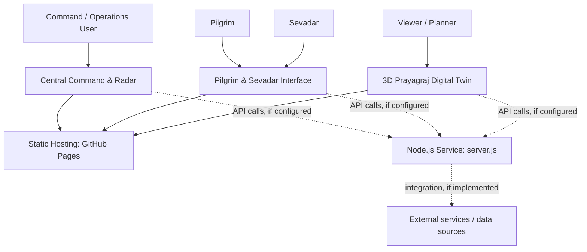
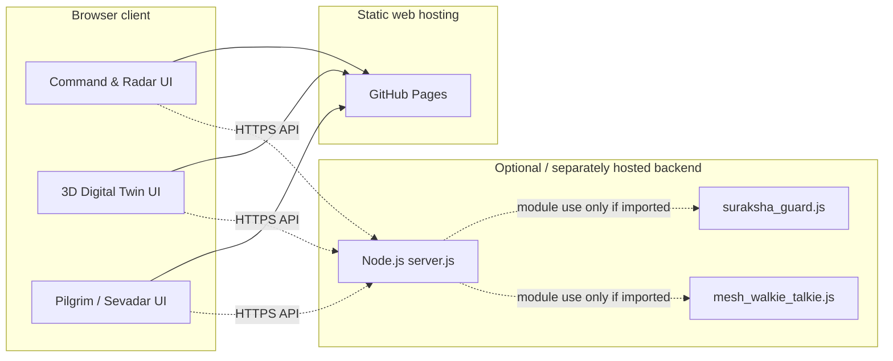
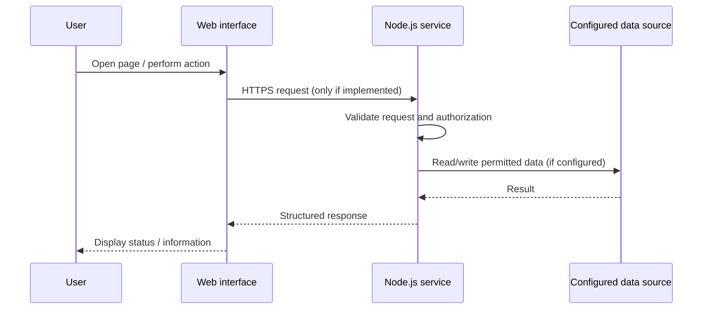

# Technical Design Document — Suraksha Kumbh

**Document status:** Initial project documentation draft  
**Repository:** https://github.com/aztanmoy07-tech/Suraksha-Kumbh  
**Live interfaces:**
- Central Command & Radar: https://aztanmoy07-tech.github.io/Suraksha-Kumbh/
- 3D Prayagraj Digital Twin: https://aztanmoy07-tech.github.io/Suraksha-Kumbh/prayagraj_twin.html
- Pilgrim & Sevadar App: https://aztanmoy07-tech.github.io/Suraksha-Kumbh/User_Interface.html

> Accuracy note: this document describes the observable application entry points and a proposed high-level system model. The exact API routes, persistence layer, authentication mechanism, data providers, and runtime behavior must be confirmed against `server.js`, the JavaScript modules, and deployment configuration before this document is treated as an implementation specification. Do not present proposed components as already implemented unless verified.

## 1. Purpose

Suraksha Kumbh is intended to support safety awareness and coordination in a large pilgrimage environment through three user-facing experiences:

1. **Central Command & Radar** — an operations-oriented overview.
2. **3D Prayagraj Digital Twin** — a spatial visualization of the Prayagraj/Kumbh environment.
3. **Pilgrim & Sevadar App** — a user-facing interface for pilgrims and service volunteers.

The goal of this document is to explain the system boundary, main user journeys, deployment model, security considerations, and validation plan.

## 2. System context

The three published pages are served as static web assets by GitHub Pages. A separate Node.js deployment is required for server-side functionality. The dotted connections are conditional and must be checked against the actual source code.

## 3. Logical architecture

This diagram is a conceptual view based on known filenames and published page URLs. Confirm module imports and actual network calls before relying on the connections shown.

## 4. Components and responsibilities

| Component | Known role / documentation interpretation | Verification required |
|---|---|---|
| Central Command & Radar | Operations-facing entry page at the repository root | Confirm widgets, data feeds, operator roles, and alert lifecycle in source |
| `prayagraj_twin.html` | 3D digital-twin page | Confirm map/3D library, scene data, controls, and data source |
| `User_Interface.html` | Pilgrim/sevadar-facing page | Confirm supported user actions and whether submissions reach a backend |
| `server.js` | Node.js server entry point | Inspect routes, middleware, port, persistence, and startup script |
| `suraksha_guard.js` | JavaScript module | Confirm whether it is imported by the server or browser |
| `mesh_walkie_talkie.js` | JavaScript module | Confirm communication protocol, dependencies, and execution context |
| `package.json` | Dependency and npm script manifest | Use its actual scripts and dependency versions |
| `vercel.json` | Vercel deployment configuration | Confirm configured build/output/routes |

## 5. Main user journeys

### 5.1 Operations user

1. Opens the Central Command & Radar page.
2. Reviews the information displayed by the interface.
3. Opens the digital twin when spatial context is needed.
4. Uses only verified, current information for operational decisions.

### 5.2 Pilgrim

1. Opens the Pilgrim & Sevadar interface.
2. Reviews available information and controls.
3. Enters only the information requested by the application.
4. Submits an action, if supported, and checks for a clear success or failure response.

### 5.3 Sevadar

1. Opens the user interface.
2. Uses the available volunteer/service workflow.
3. Confirms any submitted status or assistance request.
4. Escalates urgent situations through established real-world emergency procedures; the demo must not be treated as a replacement for emergency services.

## 6. Data flow

The intended high-level data flow, if backend integration is enabled:

For static-only features, the browser may render bundled local data without contacting a backend. Confirm actual network requests in browser developer tools.

## 7. Interfaces and deployment

| Interface | Published URL | Hosting behavior |
|---|---|---|
| Central Command & Radar | `https://aztanmoy07-tech.github.io/Suraksha-Kumbh/` | Static page on GitHub Pages |
| 3D Digital Twin | `https://aztanmoy07-tech.github.io/Suraksha-Kumbh/prayagraj_twin.html` | Static HTML page on GitHub Pages |
| Pilgrim & Sevadar App | `https://aztanmoy07-tech.github.io/Suraksha-Kumbh/User_Interface.html` | Static HTML page on GitHub Pages |

GitHub Pages does not execute Node.js. If `server.js` is required, deploy it separately and configure the frontend to call its HTTPS endpoint. Keep backend secrets in the backend host's environment settings, not in HTML or browser JavaScript.

## 8. Environment variables

The exact environment variable names are intentionally not guessed. Inspect source for `process.env`, `dotenv`, and configuration reads. Document each discovered variable using this table:

| Variable | Required? | Purpose | Example |
|---|---|---|---|
| `PORT` | Confirm in source | Server listen port, if configurable | `3000` |
| Add actual variables found in source | Confirm | Describe actual purpose | Use a non-secret placeholder |

Never place real credentials in this document or in `.env.example`.

## 9. Security, privacy, and operational safeguards

- Keep private keys and credentials out of the repository and all browser-delivered assets.
- If `key.pem` is a private key and it was pushed to a public repository, treat it as exposed: revoke/rotate it and remove it from repository history as appropriate.
- Use HTTPS for all backend communication.
- Validate inputs on the server; do not rely only on browser-side validation.
- Apply authentication and authorization to sensitive operator actions, if such actions exist.
- Minimize collection and retention of personal and location data.
- Use synthetic data in demos and test fixtures.
- Show timestamps and data freshness wherever live operational data is displayed.
- Clearly distinguish simulated/demo data from verified live data.
- Provide a fallback procedure if network connectivity or a data provider is unavailable.

## 10. Known limitations and items to verify

Before final submission, inspect the implementation and fill in:
- Exact frontend libraries and versions.
- Exact backend routes and HTTP methods.
- Authentication and authorization flow.
- Database or persistence technology, if any.
- External APIs and data providers.
- Whether walkie-talkie/mesh functionality is implemented, simulated, or a prototype.
- Whether alerts are real, simulated, or locally generated.
- Actual environment variable names.
- Automated test framework and current test coverage.
- Production backend URL and deployment procedure, if applicable.

## 11. Future improvements

- Add a verified API specification (for example, OpenAPI) if the backend exposes HTTP endpoints.
- Add automated unit and integration tests.
- Add role-based access controls for privileged workflows, if required.
- Add monitoring, structured logs, and health checks to the backend.
- Add explicit data provenance and freshness indicators to operational dashboards.
